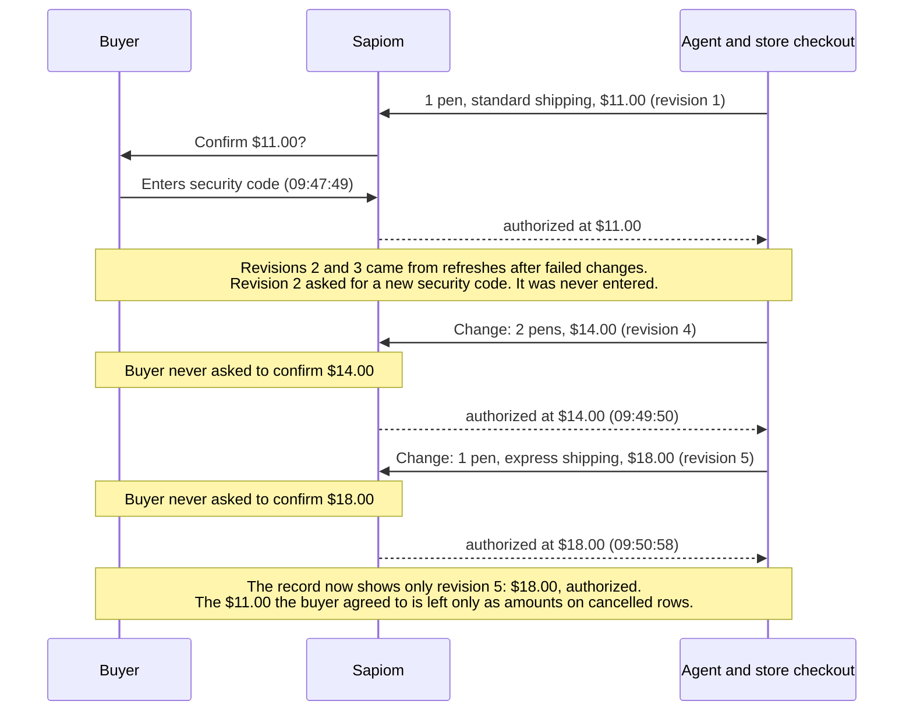
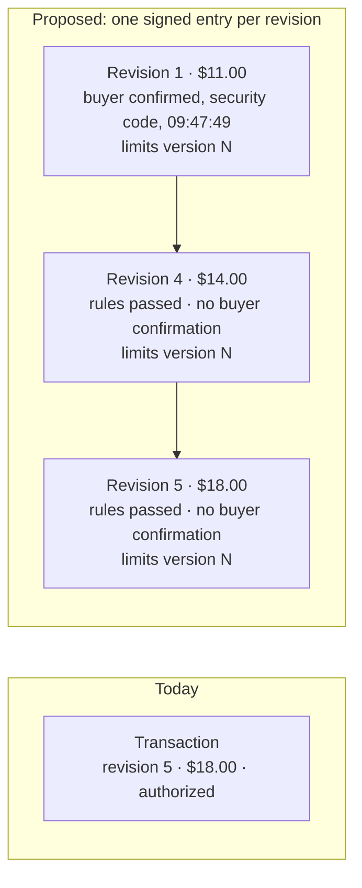

# Keeping what the buyer agreed to in Sapiom transactions

Eric Tsang · draft, 2026-11-11

I ran a purchase through the Sapiom sandbox and changed the checkout after the buyer approved it. The buyer confirmed $11.00 with their security code. After two changes, the transaction went back to `authorized` at $14.00 and then at $18.00, and the buyer was never asked about either. The final record says "$18.00, authorized". The $11.00 they actually agreed to is left only as amounts on cancelled payment and cost rows, with no items or revision attached.

No money moved at $14 or $18 (the store refused the item), so I can't say whether a security code would have been asked before payment. This is about the record, not the controls.

## What happened

Sandbox transaction `01a1c4da-604a-739e-956b-a5a9b4dac15d`, 2026-11-10, times in UTC.

## What the record keeps vs. what a dispute needs

| | Today | Needed later |
|---|---|---|
| What the buyer agreed to | Latest revision only ($18.00) | Every revision, and which one the buyer confirmed ($11.00) |
| When they agreed | `authorizedAt`, which is when Sapiom's rules passed | A separate time for the buyer's confirmation, and how they gave it |
| Which spending limit applied | Not on the transaction | The limits version each revision was checked against |
| Who can check it | Sapiom's API, as the database is at that moment | Anyone with Sapiom's public key, months later |

## What I'd change

1. **Record the buyer's confirmation separately from `authorizedAt`.** Today `authorizedAt` is when governance passed. Add a per-revision `buyerConfirmation`: `{ revision, confirmedAt, method: "security_code", paymentCardId, total, lineItems, selected fulfillment, evidenceObservationSeq, purchaseRequest.fingerprint }`. `authorizedAt` stays as is, so nothing that reads it breaks.
2. **Keep every revision.** Append-only, each with the checkout evidence Sapiom governed, the governance decision, the limits version and the buyer confirmation if there was one. Either `revisions[]` on the transaction or `GET /v1/transactions/{id}/revisions`.
3. **Stamp the limits version.** Limits already have an integer `version` (`409 RULE_VERSION_CONFLICT`). Recording it per revision answers "which limit applied?" without replaying history.
4. **Sign each confirmation in a format merchants already verify.** UCP's [AP2 Mandates extension](https://github.com/Universal-Commerce-Protocol/ucp/blob/main/docs/specification/payment/extensions/ap2-mandates.md) already defines it: the merchant signs the checkout (`ap2.merchant_authorization`), and the platform signs a `checkout_mandate` over the full checkout the user confirmed. Under "Option 1: Trusted Platform Provider", the platform signs with a server-side key on explicit user consent. That's Sapiom's role here. The sandbox store's `/.well-known/ucp` doesn't advertise the extension today, so Sapiom-signed is the starting point. The keys could share infrastructure with the signed webhooks you already have planned.

## How this relates to AP2

[AP2 v0.2](https://github.com/google-agentic-commerce/AP2/blob/main/docs/ap2/specification.md) says its mandates and receipts give "a non-repudiable picture of the transaction", but leaves "dispute resolution, retention, and retrieval requirements" out of scope. The mandates also don't say which spending limit applied or what was already spent at other merchants. I raised that second part in [AP2 #207](https://github.com/google-agentic-commerce/AP2/issues/207) and it's still open. Sapiom already tracks each card's limits and usage, so putting the limits version and the amount remaining into each signed confirmation would cover both.

## Why it matters in a dispute

"I agreed to $11, not $18" is Visa dispute 12.5, Incorrect Amount. The cardholder has "120 calendar days from the Transaction Processing Date" to raise it, and the dispute is "limited to the difference between the amounts" ([Visa Core Rules](https://www.visa.co.uk/dam/VCOM/download/about-visa/visa-rules-public.pdf), 24 Oct 2026, §11.10.4.4 and §11.10.4.2). [Visa's merchant dispute guide](https://by.visa.com/dam/VCOM/global/support-legal/documents/merchants-dispute-management-guidelines.pdf) (Oct 2026) says what can answer it: "A transaction receipt or system record that shows the correct amount and reflects the cardholder's confirmation or acceptance." A signed, per-revision confirmation is that record. A transaction that keeps only the latest revision isn't.

The networks seem to be heading the same way. Visa's Oct 2026 rules add duties for an "Agentic Payment Provider", including "at final checkout … obtaining Cardholder consent before initiating the Transaction" (§4.1.23.6) and keeping an order confirmation available "for at least 120 days from the Processing Date" (§4.1.23.8). Mastercard's [Verifiable Intent](https://github.com/agent-intent/verifiable-intent) draft (v0.1) calls for "checkout-payment integrity binding (cryptographic proof that the payment mandate references the same checkout the user approved)".

## What I don't know

- How long the record needs to stay readable. Visa's window for 12.5 is 120 days from processing. I couldn't get to Mastercard's chargeback guide.
- Whether Sapiom, the platform, or neither counts as the "Agentic Payment Provider" when the buyer confirms on Sapiom's page.
- What gets signed for browser checkout, where there's no merchant checkout object and `assertedBy` is `agent`.
- What a merchant should be able to read. SD-JWT selective disclosure fits here.
- Key custody and rotation, and whether the buyer or platform should hold a copy.

## Feedback

Tell me where this is wrong for how Sapiom works, either as an issue here or a reply to my email. If it's useful, next would be the record schema, test vectors from real sandbox transactions, and an offline verifier. This repo ([README](../README.md)) already captures and checks the platform-side version.
