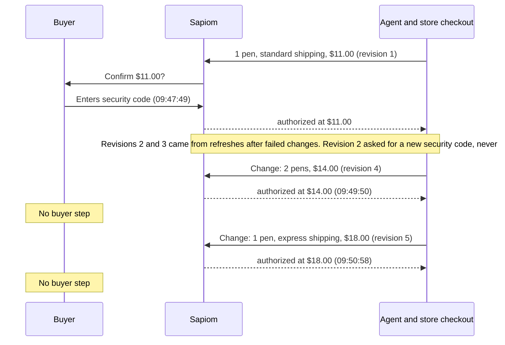
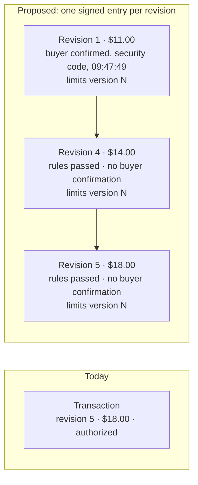

# A buyer-confirmation record for Sapiom transactions

Draft for discussion · Eric Tsang · 2026-11-11

## In one paragraph

A buyer approved an $11.00 purchase in the Sapiom sandbox. The checkout was then changed twice, and each time the transaction went back to "authorized", first at $14.00 and then at $18.00. The buyer never saw either total. Afterwards, the transaction record shows only "$18.00, authorized". The $11.00 the buyer actually agreed to survives only as amounts on cancelled payment and cost rows, with no items or revision attached. If the buyer later said "I agreed to $11, not $18", the record can't show what they agreed to. No money moved at $14 or $18, because the store refused the item, so this is about the record, not the controls.

## What happened, step by step

Sandbox transaction `01a1c4da-604a-739e-956b-a5a9b4dac15d`, 2026-11-10, times in UTC.

## What the record keeps, and what a dispute needs

| | Today | Needed when someone disputes it |
|---|---|---|
| What the buyer agreed to | Latest revision only ($18.00) | Every revision, and which one the buyer confirmed ($11.00) |
| When the buyer agreed | `authorizedAt` = when Sapiom's rules passed | A separate time for the buyer's own confirmation, and how they gave it |
| Which spending limit applied | Not referenced on the transaction | The limits version each revision was checked against |
| Who can check it | Only through Sapiom's API, as the database is at that moment | Anyone holding Sapiom's public key, months later |

## Proposal

**1. Separate the two moments.** Today `authorizedAt` is when governance passed. Add a per-revision `buyerConfirmation`: `{ revision, confirmedAt, method: "security_code", paymentCardId, total, lineItems, selected fulfillment, evidenceObservationSeq, purchaseRequest.fingerprint }`. Leave `authorizedAt` as is, so nothing that reads it breaks.

**2. Keep every revision.** Append-only: each revision with the checkout evidence Sapiom governed, the governance decision, the limits version it was checked against, and the buyer confirmation if there was one. Either as `revisions[]` on the transaction or as `GET /v1/transactions/{id}/revisions`.

**3. Stamp the limits version.** Spending limits already carry an integer `version` with `409 RULE_VERSION_CONFLICT`. Recording it per revision answers "which limit applied?" without replaying history.

**4. Sign each confirmation, in a format merchants already verify.** UCP, which Sapiom already uses for checkout, defines this in its [AP2 Mandates extension](https://github.com/Universal-Commerce-Protocol/ucp/blob/main/docs/specification/payment/extensions/ap2-mandates.md): the merchant signs the checkout (`ap2.merchant_authorization`, detached JWS over JCS), and the platform produces a `checkout_mandate` over the full checkout the user confirmed. Under "Option 1: Trusted Platform Provider", the platform signs with a server-side key on explicit user consent. That role is Sapiom's: issue a `checkout_mandate` at each buyer confirmation and store it with the revision. Where a merchant supports the extension, the mandate covers the merchant's signature too. (The sandbox store's `/.well-known/ucp` does not advertise it today, so Sapiom-signed is the starting point.) The signing keys could be the same infrastructure as the signed webhooks already planned.

## Where this sits relative to AP2

[AP2 v0.2](https://github.com/google-agentic-commerce/AP2/blob/main/docs/ap2/specification.md) says its mandates and receipts together give "a non-repudiable picture of the transaction", and leaves "dispute resolution, retention, and retrieval requirements" out of scope. Its mandates also say nothing about which spending limit applied or what had already been spent at other merchants, which is an open question I raised in [AP2 #207](https://github.com/google-agentic-commerce/AP2/issues/207). Sapiom already tracks each card's limits and usage. Putting the limits version and the amount remaining into each signed confirmation (parts 3 and 4) would cover both: the record is kept and retrievable, and it shows the limit was checked before the money moved.

## What it lets you answer later

The buyer in the test would say "I agreed to $11, not $18". On Visa, that is dispute 12.5, Incorrect Amount. The cardholder has "120 calendar days from the Transaction Processing Date" to raise it ([Visa Core Rules](https://www.visa.co.uk/dam/VCOM/download/about-visa/visa-rules-public.pdf), 24 Oct 2026, §11.10.4.4). The dispute is "limited to the difference between the amounts" (§11.10.4.2). [Visa's merchant dispute guide](https://by.visa.com/dam/VCOM/global/support-legal/documents/merchants-dispute-management-guidelines.pdf) (Oct 2026) lists what can answer it: "A transaction receipt or system record that shows the correct amount and reflects the cardholder's confirmation or acceptance." A per-revision, signed `buyerConfirmation` is that record. Today's transaction, which shows only the latest revision, is not.

Two more pointers to where the networks are heading. Neither depends on how Sapiom is classified under them.

- The Oct 2026 Visa rules add duties for an "Agentic Payment Provider". Before completing a transaction, it must get the cardholder's consent for listed items, for example "at final checkout … obtaining Cardholder consent before initiating the Transaction" (§4.1.23.6). It must also make an order confirmation available "for at least 120 days from the Processing Date" (§4.1.23.8).
- Mastercard's [Verifiable Intent](https://github.com/agent-intent/verifiable-intent) draft (v0.1) includes "checkout-payment integrity binding (cryptographic proof that the payment mandate references the same checkout the user approved)".

A record built as above answers both without a second format.

## Questions only Sapiom can answer

- Retention: how long the record must stay readable. Visa's window is 120 days from processing for 12.5. I couldn't confirm Mastercard's (their chargeback guide was not reachable).
- Classification: whether Sapiom, the platform, or neither is the "Agentic Payment Provider" when the buyer confirms on Sapiom's page.
- Browser checkout: there is no merchant checkout object, and `assertedBy` is `agent`. What gets signed there?
- Privacy: what goes in a record a merchant can read. SD-JWT selective disclosure is built for this.
- Key custody and rotation, and whether the buyer or platform should also hold a copy.

## What would help

Tell me where this is wrong for how Sapiom works: an issue on this repo, or a reply to my email. If it's useful, the next pieces are the record schema, test vectors from real sandbox transactions, and an offline verifier. This repo ([README](../README.md)) already captures and checks the platform-side version.
